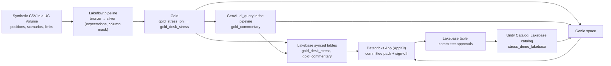

# Same-day stress testing for the risk committee

**Customer:** Kaito Bank (fictional), the markets division of a Japanese commercial bank
**Industry:** Financial services / banking, capital markets: market risk management
**Outcome map:** Capital Markets (Sellside) → Protect the firm → Risk management → *Market & Credit Risk, Stress Testing & VaR*

All data in this repository is synthetic. No customer data is used.

## 1. Business challenge

Kaito Bank's risk committee approves the trading desks' stress-test results every month and whenever markets move (a BoJ rate decision, a sharp yen rally). Today the pack takes about a week:

- Market risk analysts collect desk sensitivities from spreadsheets and reconcile them by hand.
- They write the committee commentary from scratch for every scenario.
- Committee members' follow-up questions ("what drives the yen loss?", "how much headroom does Equity have?") go back to the analysts and take one to two days each.

So the committee decides on numbers that are already about five days old. A desk limit breach under stress is visible only when the pack is finished, which leaves the CRO carrying an unmanaged excess for that time.

## 2. Business outcomes and impact

| KPI (buyer) | Today (assumed) | With this solution | Impact |
|---|---|---|---|
| Time from scenario to committee pack | 5 business days | Same day (pipeline and sync in minutes, then analyst review) | Decisions on current numbers |
| Time to see a desk limit breach under stress | When the pack is done (T+5) | As soon as the pipeline runs (T+0) | Breaches managed about 5 days earlier |
| Follow-up questions from the committee | 1–2 days each, by an analyst | Answered in the meeting with Genie, SQL shown | Fewer meetings rolled over |
| Analyst effort per cycle | 24 person-days | 3 person-days | **About 378 person-days a year (≈1.6 FTE), ≈JPY 24M (≈USD 160k) a year** |

In the demo data, the yen-surge scenario puts the FX desk JPY 3.6bn over its JPY 8.0bn stress loss limit. The committee sees it, reads the AI draft commentary, asks Genie for the drivers, and records "action requested" in one screen.

**These numbers are estimates for illustration, to be validated with the customer in discovery.** Assumptions:

- 18 cycles a year (12 monthly committees and 6 ad hoc scenario requests).
- Today: 4 analysts × 5 days = 20 person-days to build the pack, plus 8 follow-up questions × 0.5 person-day = 4. Total 24.
- With the solution: 2 analysts × 1 day to review the pack and the AI commentary = 2 person-days, and 2 of the 8 follow-ups still go to an analyst = 1. Total 3.
- Saving: (24 − 3) × 18 = 378 person-days. At 240 working days and a loaded cost of JPY 15M per analyst a year, that is ≈1.6 FTE and ≈JPY 24M a year.
- Not counted: the value of managing a limit excess earlier, which depends on the bank's risk appetite.

**For the executive sponsor (CRO):** the committee decides on today's risk, breaches surface the same day, and every number and AI sentence can be traced to its source.
**For the domain owner (Head of Market Risk):** the team stops rebuilding spreadsheets and drafting text, and spends its time on judgement and on challenging the desks.

## 3. Solution and data journey

One connected flow. Each stage's output is the next stage's input, and every hop can be traced by table name.

| Stage | What it does | Where |
|---|---|---|
| Raw data | 202 positions (2 deliberately invalid), 4 scenarios × 8 risk factors, 4 desk limits, all synthetic with a fixed seed | `notebooks/00_generate_data.ipynb` |
| **Lakeflow** | Serverless Spark Declarative Pipeline. Auto Loader into bronze, typed silver with expectations that drop invalid rows, gold stressed P&L = sensitivity × shock, then P&L by desk against its limit | `pipeline/*.sql`, `notebooks/01_pipeline.ipynb` |
| **Unity Catalog** | One catalog for the lakehouse and one for the Lakebase database. Column mask on `counterparty` (only `risk_admins` see names), lineage from Volume to gold, table and column comments. The app's service principal has no UC grants; Genie runs as the user | `notebooks/00`, `pipeline/silver.sql`, `notebooks/04_app.ipynb` |
| **GenAI** | `ai_query` (Claude Sonnet on Databricks) inside the pipeline writes a three-sentence committee commentary per scenario: top desk and top two risk factors, why, and what to decide. It is grounded only in a `facts` column stored next to it | `pipeline/gold.sql` (`gold_commentary`) |
| **Lakebase** | Postgres project with synced tables for the two gold tables the app reads, plus an app-owned `committee.approvals` table for sign-offs. The database is registered in UC, so decisions made in the app are queryable from the lakehouse with no reverse pipeline | `notebooks/02_lakebase.ipynb`, `app/server/server.ts` |
| **Genie** | Genie space over the three gold tables and the approvals table, with column descriptions, synonyms, two checked example SQLs and five sample questions. It joins Delta gold with Lakebase approvals ("which scenarios are not signed off yet?") | `genie/space.json`, `notebooks/03_genie.ipynb` |
| **App** | AppKit app: stress table with limit use, the AI commentary with a "verify" note, Sign off / Request action buttons, and an embedded Genie chat that shows its SQL and runs on behalf of the signed-in user | `app/`, `notebooks/04_app.ipynb` |

## 4. Evidence it ran

Every notebook was run against a Databricks workspace (serverless, through Databricks Connect) and committed with its outputs. Read the outputs as text:

| Notebook | What the output shows |
|---|---|
| `00_generate_data.ipynb` | Rows written to the Volume and read back |
| `01_pipeline.ipynb` | Pipeline update `COMPLETED`; expectations passed and dropped per rule (2 invalid rows dropped); row counts per layer; P&L by desk; desk vs limit with the two breaches; the four AI commentaries with their facts; `REDACTED` counterparties |
| `02_lakebase.ipynb` | Lakebase project and UC registration; synced tables `ONLINE`; the served data read back through the Lakebase catalog |
| `03_genie.ipynb` | The five sample questions asked through the Genie Conversation API, with the SQL Genie wrote, the result rows and the answer |
| `04_app.ipynb` | App deployed and `RUNNING`; the app's scopes and zero UC grants; the committee pack read from Lakebase through the app API; a decision recorded through the app and read back in Unity Catalog; a Genie question asked through the app with SQL and rows |

The app also passes `databricks apps validate` (type check, lint, build, tests).

## 5. AI tools, workflow, decisions and trade-offs

### How AI was used

- **Tool:** Claude Code (Claude Opus) as a pair builder, with the Databricks agent skills (`databricks-core`, `databricks-pipelines`, `databricks-lakebase`, `databricks-apps`, `databricks-app-design`, `databricks-genie-agents`, `databricks-execution-compute`). The skills kept the agent on current CLI and SDK APIs instead of guessed ones.
- **Contract file:** [`AGENTS.md`](AGENTS.md) (in Japanese) is the brief the agent works from: scope, data shape, what *not* to build, and every human decision with its date. It also says the agent must ask before it decides anything about scope or the story.
- **Working rules:** KISS, YAGNI and DRY written as concrete, checkable rules (sensitivity × shock only, one app screen, every name in `config.yml`).
- **Patterns:** walking skeleton first (CSV → pipeline → Lakebase → one app table, deployed on day one), then one stage at a time. Evidence as text from the start: notebooks run locally against serverless and committed with outputs.
- **Human in the loop:** I chose the problem (stress testing over card fraud), Lakebase-first serving over warehouse reads, Genie inside the app, and what the commentary must say. The agent proposed options with trade-offs. Where AI review caught issues, I decided the fix:
  - The first synthetic book made money in every crash, so position direction was fixed to a typical long bank book.
  - The metastore had no storage root, so the catalog got a managed location.
  - Genie through the app failed with a scope error, so Genie moved to on-behalf-of-user and the service principal's UC grants were revoked.

### Decisions and trade-offs

| Decision | Why | Trade-off / next step |
|---|---|---|
| Stressed P&L = sensitivity × shock | Fast, explainable to a committee, standard first-order view | Misses convexity (options, large moves). Full revaluation can replace the gold step without changing anything downstream |
| Lakeflow SQL pipeline with expectations | Declarative, lineage in UC, data quality counts in the event log | Full refresh on every run, because the synthetic files are regenerated. Production would be incremental |
| AI commentary generated in the pipeline, stored with its facts | Generated once per run, auditable, the same text in the app and in Genie, no LLM call at page load | A human still signs off. The prompt allows only the numbers in `facts` |
| Lakebase for serving and write-back | Sub-second reads for the committee screen and transactional writes for decisions. UC registration makes decisions visible to the lakehouse and to Genie | Synced tables don't carry UC masks, so only gold (no counterparty column) is synced |
| Genie on behalf of the user | Unity Catalog applies each user's own permissions, including the mask. The app's service principal needs no UC grants | Each user needs `SELECT` on the gold tables |
| Snapshot sync | Simplest for a full-refresh demo | Triggered sync with change data feed in production |

**Considered and not built (YAGNI):** registering new scenarios from the app and recomputing (needs job triggering and a Lakebase → Delta path); VaR / Expected Shortfall / full revaluation; a trained ML model (the GenAI step meets the "ML or GenAI" stage); multiple screens; CI.

## How to run

Prerequisites: Databricks CLI with a profile (set it in `config.yml`), Python 3.12, Node 22 with pnpm, `psql`. Unity Catalog with Lakebase, serverless compute and the `ai_query` foundation model endpoint named in `config.yml`.

1. Create the catalog once: `databricks catalogs create stress_demo` (add `--storage-root` if your metastore has no storage root).
2. `uv venv --python 3.12 .venv && uv pip install --python .venv/bin/python "databricks-connect>=16.4,<17.4" nbconvert nbclient ipykernel pyyaml requests`
3. Run the notebooks in order: `00` → `01` → `02` → `03` → `04` (for example `jupyter nbconvert --to notebook --execute --inplace notebooks/<name>.ipynb`). Notebook `04` deploys the app from `app/` with its bundle. Set `genie_space_id` in `app/databricks.yml` to the space that `03` created.
